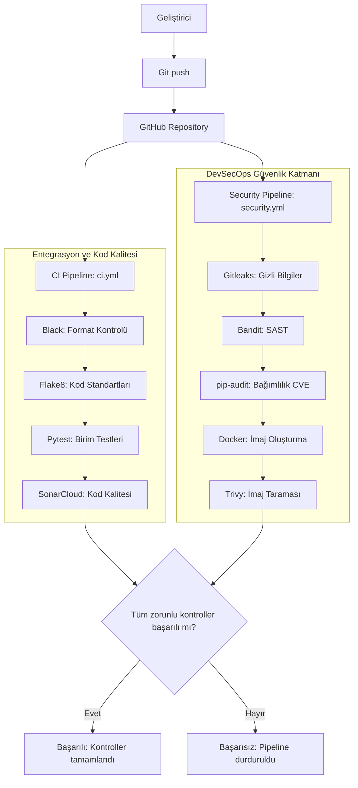

# 🔐 SecureFlow: CI/CD Süreçlerinde Otomatik Zafiyet Araması ve DevSecOps Boru Hattı


**SecureFlow**, modern yazılım geliştirme yaşam döngüsünde (SDLC) güvenlik açıklarını erken aşamada tespit etmek amacıyla geliştirilmiş, otomatik bir **DevSecOps CI/CD boru hattıdır (pipeline)**. Proje, güvenlik kontrollerini yazılım geliştirme sürecinin ilk aşamalarına entegre eden **Shift-Left Security (Güvenliği Sola Kaydırma)** prensibini benimser.

## 📑 İçindekiler

- [Projenin Amacı ve Kapsamı](#-projenin-amacı-ve-kapsamı)
- [Kullanılan Teknolojiler ve Araçlar](#️-kullanılan-teknolojiler-ve-araçlar)
- [Proje Mimarisi ve Dizin Yapısı](#-proje-mimarisi-ve-dizin-yapısı)
- [CI/CD Süreç Akışı](#️-cicd-süreç-akışı-ve-işleyiş-mekanizması)
- [Süreç Akış Şeması](#-cicd-süreç-akış-şeması)
- [Kurulum ve Yerel Çalıştırma](#-kurulum-ve-yerel-çalıştırma)
- [Benchmark Veri Seti](#-benchmark-veri-seti)
- [Süreç Günlükleri](#-süreç-günlükleri)
- [Geliştirici](#-geliştirici)

---

## 🚀 Projenin Amacı ve Kapsamı

Geleneksel yazılım geliştirme süreçlerinde güvenlik testleri çoğunlukla geliştirme döngüsünün son aşamalarında gerçekleştirilir. Bu durum, güvenlik açıklarının geç tespit edilmesine, düzeltme maliyetlerinin artmasına ve üretim ortamında risk oluşmasına neden olabilir.

**SecureFlow**, kod geliştirme aşamasından konteyner imajının oluşturulmasına kadar uzanan süreçte otomatik güvenlik ve kalite kontrolleri gerçekleştirmeyi hedefler.

Projenin temel özellikleri:

- 🔎 **Statik Kod Analizi (SAST):** Python kaynak kodundaki potansiyel güvenlik açıklarını tespit eder.
- 🔑 **Gizli Bilgi Taraması:** Kaynak koduna yanlışlıkla eklenen API anahtarlarını, parolaları ve diğer gizli bilgileri arar.
- 📦 **Bağımlılık Güvenliği (SCA):** Üçüncü taraf Python paketlerindeki bilinen güvenlik açıklarını kontrol eder.
- 🐳 **Konteyner Güvenliği:** Docker imajlarını işletim sistemi paketleri ve bağımlılıklardaki bilinen zafiyetler açısından tarar.
- 🧪 **Otomatik Testler:** Birim testleri aracılığıyla uygulamanın beklenen davranışlarını doğrular.
- 📊 **Kod Kalitesi Analizi:** Kod standartlarını ve yazılım kalitesini değerlendirir.
- 🚫 **Güvenlik Kapıları (Security Gates):** Tanımlanan hata eşiklerine göre başarısız olan kontrollerin CI/CD sürecini durdurmasını sağlar.

> **Temel hedef:** Güvenlik kontrollerini yazılım geliştirme sürecinin ayrılmaz bir parçası hâline getirmek ve zafiyetlerin daha erken aşamalarda tespit edilmesini sağlamak.

## 🛠️ Kullanılan Teknolojiler ve Araçlar

| Kategori | Araç / Teknoloji | Açıklama |
|---|---|---|
| CI/CD Otomasyonu | GitHub Actions | Otomatik iş akışlarını ve kalite kontrollerini çalıştırır. |
| Programlama Dili | Python 3.x | Uygulama ve test kodlarının geliştirilmesinde kullanılır. |
| Statik Kod Analizi (SAST) | Bandit | Python kodundaki potansiyel güvenlik sorunlarını tespit eder. |
| Kod Formatlama | Black | Python kodunun tutarlı biçimlendirilmesini sağlar. |
| Kod Standartları | Flake8 | Stil ve lint kontrollerini gerçekleştirir. |
| Bağımlılık Güvenliği (SCA) | pip-audit | Python bağımlılıklarını bilinen güvenlik açıklarına karşı kontrol eder. |
| Gizli Bilgi Taraması | Gitleaks | Kod deposundaki olası gizli bilgi sızıntılarını tespit eder. |
| Konteynerleştirme | Docker | Uygulamayı konteyner imajı olarak paketler. |
| Konteyner Güvenliği | Trivy | İmaj ve desteklenen bileşenlerdeki bilinen zafiyetleri tarar. |
| Kod Kalitesi | SonarCloud | Kod kalitesini ve yapılandırmaya bağlı statik analiz bulgularını değerlendirir. |
| Birim Testleri | Pytest | Uygulamanın işlevselliğini otomatik olarak test eder. |

## 📂 Proje Mimarisi ve Dizin Yapısı

```text
secureflow-devsecops-pipeline/
│
├── .github/
│   └── workflows/
│       ├── ci.yml
│       └── security.yml
│
├── app/
│   ├── __init__.py
│   ├── database.py
│   └── main.py
│
├── benchmark_dataset/
│   ├── cwe_89_sqli.py
│   ├── cwe_78_cmd_injection.py
│   └── cwe_327_broken_crypto.py
│
├── docs/
│   └── cicd-log.md
│
├── tests/
│   └── test_app.py
│
├── Dockerfile
├── requirements.txt
└── README.md
```

### 📁 Dizinlerin ve Dosyaların Görevleri

- **`.github/workflows/ci.yml`**: Kod formatlama, stil kontrolleri, birim testleri ve yapılandırılmışsa SonarCloud analizini yürütür.
- **`.github/workflows/security.yml`**: Gitleaks, Bandit, pip-audit, Docker ve Trivy gibi güvenlik araçlarını çalıştırır.
- **`app/`**: Uygulamanın kaynak kodlarını ve veritabanı bağlantı yönetimini içerir.
- **`benchmark_dataset/`**: Güvenlik araçlarının tespit başarısını değerlendirmek için hazırlanmış kontrollü zafiyet örneklerini barındırır.
- **`docs/cicd-log.md`**: Geliştirme sürecini, karşılaşılan sorunları, tespit edilen bulguları ve uygulanan çözümleri kaydetmek için kullanılır.
- **`tests/`**: Pytest ile çalıştırılan otomatik testleri içerir.
- **`Dockerfile`**: Uygulamanın Docker imajının oluşturulmasını tanımlar.
- **`requirements.txt`**: Python bağımlılıklarını listeler.

> Not: Bu dizin yapısı hedeflenen proje mimarisini gösterir. Dosyaların gerçekten çalışır durumda olması için ilgili içeriklerin oluşturulması ve yapılandırılması gerekir.

## ⚙️ CI/CD Süreç Akışı ve İşleyiş Mekanizması

SecureFlow, GitHub deposuna kod gönderildiğinde veya ilgili iş akışı tetiklendiğinde otomatik kontroller gerçekleştirecek şekilde tasarlanmıştır.

### 1. CI Pipeline — Kod Kalitesi ve Testler

- **Black:** Kod biçimlendirmesini kontrol eder.
- **Flake8:** Kod stili ve lint kontrollerini gerçekleştirir.
- **Pytest:** Birim testlerini çalıştırır.
- **SonarCloud:** Yapılandırılmışsa kod kalitesi analizini gerçekleştirir.

### 2. Security Pipeline — Güvenlik Taramaları

- **Gitleaks:** Gizli bilgi sızıntılarını arar.
- **Bandit:** Python kodundaki potansiyel güvenlik sorunlarını analiz eder.
- **pip-audit:** Bağımlılıkların bilinen güvenlik açıklarını kontrol eder.
- **Docker:** Uygulama imajını oluşturur.
- **Trivy:** Oluşturulan imajı bilinen güvenlik açıklarına karşı tarar.

### 3. Güvenlik Kapıları ve Sonuç

İş akışları, yapılandırılan kurallara göre başarılı veya başarısız sonuçlanır. Kritik güvenlik bulgularının pipeline'ı durdurması için araçların hata kodları ve güvenlik eşikleri uygun şekilde yapılandırılmalıdır.

**Önemli:** Bir aracın yalnızca çalıştırılması, her zafiyette pipeline'ın otomatik olarak duracağı anlamına gelmez. Örneğin Trivy için `--exit-code`, Bandit için hata eşiği ve pip-audit için başarısızlık davranışı açıkça yapılandırılmalıdır.

## 📈 CI/CD Süreç Akış Şeması

Aşağıdaki şema, CI ve güvenlik taramalarının paralel olarak çalıştığı örnek bir iş akışını göstermektedir.



> Bu şema hedeflenen mantıksal akışı gösterir. Gerçek çalıştırma sırası, GitHub Actions dosyalarındaki `jobs`, `needs`, tetikleyiciler ve hata politikalarına bağlıdır. Şemada üretime dağıtım hedefi gösterilmemiştir; gerçek bir dağıtım aşaması ayrıca yapılandırılmalıdır.

## 💻 Kurulum ve Yerel Çalıştırma

### Gereksinimler

- Python 3.x
- Git
- Docker
- Trivy
- Proje bağımlılıkları
- İsteğe bağlı: SonarCloud hesabı ve GitHub Actions için gerekli yapılandırmalar

### 1. Depoyu Klonlama

Aşağıdaki komutta `<kullanici-adi>` bölümünü gerçek GitHub kullanıcı adınızla değiştirin.

```bash
git clone https://github.com/<kullanici-adi>/secureflow-devsecops-pipeline.git
cd secureflow-devsecops-pipeline
```

### 2. Sanal Ortam Oluşturma

**Windows (PowerShell):**

```powershell
python -m venv venv
.\venv\Scripts\Activate.ps1
```

**Windows (CMD):**

```bat
python -m venv venv
venv\Scripts\activate.bat
```

**Linux / macOS:**

```bash
python3 -m venv venv
source venv/bin/activate
```

### 3. Bağımlılıkları Yükleme

```bash
python -m pip install --upgrade pip
pip install -r requirements.txt
```

### 4. Kod Kalitesi Kontrolleri

```bash
black --check .
flake8 .
```

### 5. Birim Testlerini Çalıştırma

```bash
pytest -v tests/
```

### 6. Güvenlik Taramaları

**Bandit — Python kaynak kodu:**

```bash
bandit -r app/
```

**pip-audit — Bağımlılıklar:**

```bash
pip-audit -r requirements.txt
```

**Gitleaks — Depodaki gizli bilgiler:**

```bash
gitleaks detect --source . --redact
```

> Gitleaks sürümüne göre komut seçenekleri değişebilir. Kullandığınız sürümün yardım çıktısını kontrol edin. Gerçek gizli bilgiler tespit edilirse bunları yalnızca depodan silmek yeterli değildir; ilgili anahtarları veya parolaları iptal edip yenilemek gerekir.

### 7. Docker İmajını Oluşturma

```bash
docker build -t secureflow:latest .
```

### 8. Trivy ile İmajı Tarama

Yüksek ve kritik önem seviyesindeki açıklar bulunduğunda komutun başarısız olmasını sağlayan örnek:

```bash
trivy image --severity HIGH,CRITICAL --exit-code 1 secureflow:latest
```

Bu komut, seçilen önem seviyelerinde bulgu varsa sıfırdan farklı bir çıkış kodu döndürür. Bu eşik, projenin güvenlik politikasına göre ayarlanabilir.

### 9. Sonuçları Değerlendirme

Kontroller tamamlandıktan sonra:

1. Hata veren testleri ve güvenlik araçlarının raporlarını inceleyin.
2. Tespit edilen bulguları önem derecelerine göre sınıflandırın.
3. Güvenli kod düzeltmelerini yapın.
4. Testleri ve taramaları yeniden çalıştırın.
5. Önemli adımları `docs/cicd-log.md` dosyasına kaydedin.

## 🔐 GitHub Actions ve SonarCloud Yapılandırması

CI/CD iş akışlarının GitHub üzerinde çalışabilmesi için aşağıdaki ayarların proje ihtiyaçlarına göre yapılması gerekir:

- `.github/workflows/ci.yml` ve `.github/workflows/security.yml` dosyalarının oluşturulması.
- Workflow tetikleyicilerinin (`push`, `pull_request` gibi) tanımlanması.
- Gerekli Python ve araç sürümlerinin belirlenmesi.
- SonarCloud kullanılıyorsa proje ve organizasyon bilgilerinin yapılandırılması.
- Gereken token ve anahtarların GitHub Actions Secrets üzerinden güvenli şekilde sağlanması.
- Kritik güvenlik kontrollerinin başarısız olması durumunda iş akışının başarısız sonuçlanmasının sağlanması.
- Ana dal için gerekli kontrolleri zorunlu kılan branch protection kurallarının etkinleştirilmesi.

**Güvenlik önerisi:** Token, parola veya API anahtarlarını kaynak koda ya da `requirements.txt` dosyasına yazmayın. En az yetki ilkesini uygulayın ve GitHub Actions izinlerini mümkün olduğunca kısıtlı tutun.

## 🧪 Benchmark Veri Seti

`benchmark_dataset/` dizini, güvenlik tarama araçlarının tespit performansını değerlendirmek amacıyla kontrollü örnekler içerir.

| Dosya | CWE | Zafiyet Türü |
|---|---|---|
| `cwe_89_sqli.py` | CWE-89 | SQL Injection |
| `cwe_78_cmd_injection.py` | CWE-78 | OS Command Injection |
| `cwe_327_broken_crypto.py` | CWE-327 | Güvensiz veya zayıf kriptografik algoritma kullanımı |

Bu örnekler, araçların beklenen bulguları tespit edip etmediğini değerlendirmek ve güvenlik kapılarının davranışını test etmek amacıyla kullanılabilir.

> ⚠️ **Güvenlik uyarısı:** Bilinçli olarak zafiyetli hazırlanmış dosyalar yalnızca kontrollü eğitim ve test ortamlarında kullanılmalıdır. Bu dosyaları üretim uygulamasına dahil etmeyin veya herkese açık çalışan bir sisteme dağıtmayın. Benchmark sonuçları, kullanılan araçların tüm güvenlik açıklarını tespit ettiğini kanıtlamaz.

## 📝 Süreç Günlükleri

Geliştirme ve test aşamalarında gerçekleştirilen işlemler `docs/cicd-log.md` dosyasında kayıt altına alınır.

Günlükte aşağıdaki bilgiler tutulabilir:

- Gerçekleştirilen geliştirme aşaması.
- Çalıştırılan komutlar ve testler.
- Tespit edilen güvenlik bulguları.
- Karşılaşılan hatalar ve uygulanan çözümler.
- Pipeline sonuçları.
- Yapılan güvenlik iyileştirmeleri.
- Henüz giderilmemiş sorunlar ve sonraki adımlar.

Bu kayıtlar, projenin geliştirme sürecini izlemeyi ve teknik kararları açıklamayı kolaylaştırır.

## 🎯 Projenin Kazandırdıkları

SecureFlow projesi üzerinde çalışmak aşağıdaki konularda deneyim kazanılmasına yardımcı olur:

- Git ve GitHub ile sürüm kontrolü.
- GitHub Actions kullanarak CI/CD iş akışları geliştirme.
- Shift-Left Security ve DevSecOps yaklaşımı.
- SAST, SCA ve gizli bilgi taraması.
- Docker imajı oluşturma ve konteyner güvenliği.
- Otomatik test ve kod kalitesi kontrolleri.
- Güvenlik kapıları ve pipeline hata yönetimi.
- Güvenlik bulgularını belgeleme ve düzeltme.

## 👤 Geliştirici

**Muhammed Fatih Saltan**

Fırat Üniversitesi — Teknoloji Fakültesi, Yazılım Mühendisliği

---

*SecureFlow, yazılım geliştirme süreçlerinde otomatik güvenlik kontrollerini uygulamayı ve DevSecOps becerilerini geliştirmeyi amaçlayan bir projedir. Güvenlik araçlarının sonuçları, uygulamanın tek başına tamamen güvenli olduğunu garanti etmez.*
